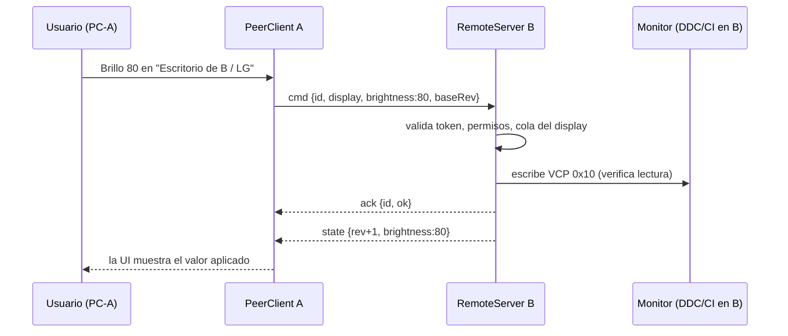

# Multi-Device Sync y control unificado de monitores — estudio de arquitectura

Estado: **propuesta, nada implementado** (06/11/2026). Parte de lo que el Lab ya tiene (`RemoteServer`, `PhoneStore`, `PhoneBridge`, `PhonePage`, `MonitorIdentity`).

## 1. Resumen y recomendación

- **Es viable y gran parte ya existe.** Cada instalación de Windows ya es un servidor con autenticación, descubrimiento en la LAN y un protocolo JSON de control completo (brillo, perfiles, modos, entradas, volumen, pantalla principal). Hoy ese servidor solo atiende teléfonos y navegadores. Lo que falta es que **otra instalación de Windows sea cliente de ese mismo servidor**, una identidad de equipo y de grupo, y reglas de conflicto.
- **Arquitectura recomendada: malla P2P ligera, sin coordinador.** Cada PC es la **única fuente de verdad de los displays que tiene conectados por cable**. Cualquier instalación autorizada puede actuar como controlador remoto contra el servidor de otra. No hay servidor central ni nube.
- **Por qué:** DDC/CI solo se puede hablar desde el equipo que tiene el cable (y, en el escenario B, solo desde el que está en la entrada activa). Un coordinador no puede hablar con el monitor; solo reenviaría. Añadiría un punto de fallo y una elección de líder sin ganar nada.
- **El escenario B (dos PC, un monitor) es posible solo en parte.** Se puede reconocer que dos vistas son el mismo monitor físico y enrutar el comando al PC que realmente lo alcanza, pero **no se puede asumir que ambos PC tienen DDC/CI** (en el LG 29WK600, con otra entrada activa el driver rechaza toda escritura).
- **Plan:** MVP en torno a 3–4 semanas de trabajo (ver §10), empezando por emparejar PC con PC y controlar brillo, perfiles y entradas del otro equipo, sin sincronizar perfiles.

## 2. Viabilidad según la arquitectura actual

| Pieza que ya existe | Qué hace hoy | Qué aporta al multi-dispositivo |
|---|---|---|
| `RemoteServer` (`Core/Remote`) | TCP 47820: HTTP + WebSocket `/ws`, JSON en ambos sentidos | El servidor de cada PC ya sirve. No hace falta otro. |
| Descubrimiento UDP 47821 | El teléfono difunde `SWITCHMONITOR?`; cada PC responde `{app, computer, port}` | Sirve tal cual para listar PC en la LAN (hay que añadir el id del equipo). |
| `PhoneStore` | Código de 6 dígitos (2 min, 5 intentos), token guardado como SHA-256 y sellado con DPAPI, desafío HMAC mutuo | El emparejamiento y la autenticación se reutilizan como "emparejamiento entre equipos". |
| `PhoneBridge` | Construye el estado (displays, perfiles, modos, volumen) y ejecuta los comandos | Es la API remota. Un PC cliente solo necesita hablarla. |
| `MonitorIdentity.Key` | `deviceId\|índice` de Windows, estable por instalación | Base del id de display. No identifica el monitor físico entre dos PC. |
| `PhonePage` / app Android | Cliente ya existente del mismo protocolo | Ya valida que el protocolo sirve para un cliente externo. |
| `SceneApplier` + `applyGate` | Serializa los cambios de perfil en un PC | Modelo para serializar comandos por display. |

**Lo que no existe:** una instalación de Windows que actúe como cliente (`PeerClient`), identidad de equipo y de grupo, inventario de displays de varios equipos, arbitraje entre controladores, reconexión con estado y una interfaz para elegir equipo.

## 3. Arquitectura recomendada: malla P2P, cada PC dueño de lo suyo

```
        +-----------------+          +-----------------+
        |   PC-A (dueño)  |<-------->|   PC-B (dueño)  |
        |  displays A1,A2 |  WS+JSON |  display B1     |
        |  RemoteServer   |          |  RemoteServer   |
        |  PeerClient     |          |  PeerClient     |
        +--------^--------+          +--------^--------+
                 |  WS (mismo protocolo)      |
          +------+-------+             +------+-------+
          |  Teléfono /  |             |   Navegador  |
          |  Android     |             |   (Web UI)   |
          +--------------+             +--------------+
```

**Reglas**

1. **Dueño del display:** el PC que lo lee por DDC/CI/WMI. Solo él escribe al hardware.
2. **Controlador:** cualquier instalación autorizada. Envía comandos al dueño; no toca el monitor.
3. **Estado:** el dueño publica estado con un número de revisión (`rev`) que sube con cada cambio. Los demás guardan una copia, nunca otra verdad.
4. **Cada equipo funciona solo.** Si la red cae, cada PC controla sus monitores igual que hoy. El multi-dispositivo es una capa añadida.

**Alternativa descartada: coordinador local.** Un PC (o un proceso) que reúne todo. Ventajas: una sola conexión por cliente y un lugar para arbitrar. Desventajas: hay que elegir y reelegir líder, si cae el líder no se controla nada aunque el monitor esté bien, y no mejora la fiabilidad del hardware. Solo tendría sentido con muchos equipos (decenas), que no es el caso.

**Alternativa descartada: servicio en la nube.** Contradice el requisito de funcionar en local y añade cuentas, privacidad y latencia.

## 4. Descubrimiento en la LAN

| Opción | Ventajas | Desventajas | Veredicto |
|---|---|---|---|
| **UDP broadcast actual** (47821) | Ya implementado y probado con Android; cero dependencias | No cruza subredes ni VLAN; algunos Wi-Fi aíslan clientes; Windows pide regla de firewall | **MVP** |
| **mDNS/DNS-SD** (`_switchmonitor._tcp`) | Estándar; lo entienden otros dispositivos; cruza segmentos con reflector | Sin dependencias de terceros hay que implementarlo a mano (multicast 224.0.0.251:5353) o usar `DnsServiceBrowse` de Windows 10 1809+ vía P/Invoke | Fase 3 |
| **Lista manual por IP/nombre** | Funciona donde el broadcast no llega | El usuario escribe la dirección | Siempre disponible como respaldo |

La respuesta de descubrimiento añadirá `deviceId`, `protocol` y un `groupHint` (hash corto del grupo, no el secreto) para listar solo los equipos del mismo grupo y no revelar nada a los demás.

## 5. Transporte y comunicación

- **WebSocket sobre el HTTP existente.** Conserva el protocolo (mensajes `state`, `brightness`, `profile`, `mode`, `input`, `cycle`, `main`, `preferred`, `volume`, `mute`). Añadiría: `inventory` (lista de displays del equipo), `ping/pong`, `cmd` con id y `rev` base.
- **Por qué no REST puro:** el estado cambia desde los dos lados (alguien toca el monitor o el otro PC) y hay que empujarlo; el WebSocket ya lo resuelve.
- **TLS:** hoy el tráfico va en claro por HTTP (el desafío HMAC evita enviar el token, pero no cifra). Para PC↔PC recomiendo **HMAC por mensaje con contador** en la fase 2 y **TLS con certificado autofirmado fijado (pinning)** en la fase 3. Es una limitación real de la LAN de confianza.
- **Web UI vía proxy del PC:** el navegador se conecta a un solo PC; ese PC abre su propia conexión al otro y reenvía. Así el navegador nunca recibe los tokens de otros equipos.



## 6. Modelo de identificación y asociación

**Equipo**

- `deviceId`: GUID generado en el primer arranque y guardado en `%LOCALAPPDATA%`. No se usa el nombre del PC ni el hardware, porque cambian.
- `name`: nombre visible editable.
- `protocol`: versión del protocolo, para negociar y rechazar versiones incompatibles.

**Grupo y vínculo**

- `groupId`: GUID del grupo, creado en el primer equipo ("Crear grupo").
- Emparejamiento con el código de 6 dígitos que ya existe, con un tipo nuevo "equipo" junto a "teléfono".
- **Credencial por par** (A guarda un token para hablar con B y B otro para A), no un secreto de grupo único. Así un equipo se revoca solo, sin cambiar el secreto de todos. Se guarda como hoy: hash SHA-256 en `phones.json`-like y secreto sellado con DPAPI.
- Permisos por par: ver, brillo, perfiles, entradas (no volumen del sistema por defecto).

**Display**

```
DisplayRef       = (deviceId, monitorKey)      // monitorKey = MonitorIdentity.Key (ya existe)
PhysicalMonitor  = { id, fingerprint?, views: [DisplayRef + input propio] }
fingerprint      = EDID fabricante + producto + serie + semana/año   // solo si la serie es única
```

- **Escenario A** solo necesita `DisplayRef`: la lista se agrupa por equipo.
- **Escenario B** necesita `PhysicalMonitor`. La `fingerprint` se lee de la EDID (ya hay lectura en `BuiltInProbe`). Muchos monitores baratos tienen serie 0 o repetida; en ese caso la relación **la confirma el usuario** ("estos dos son el mismo monitor") y se guarda, nunca se supone por el modelo.
- **Mapa de entradas:** el usuario indica "HDMI 1 = PC-A, DisplayPort = PC-B". Con eso se sabe quién es el dueño activo según la entrada que el monitor reporta.

## 7. Escenario B: dos equipos, un monitor

Hechos del proyecto (LG 29WK600): con el monitor en otra entrada, el driver Intel rechaza toda escritura DDC. Por lo tanto:

1. **Quién puede hablar con el monitor** = el equipo cuya entrada está activa y cuya lectura DDC responde. Se calcula con una prueba de salud (lectura reciente correcta), no con el id compartido.
2. **Cambiar de entrada hacia el otro PC** debe ejecutarlo el equipo activo (o enrutarse a él). Una vez cambiado, el otro PC pasa a poder hablar con el monitor.
3. **Volver desde el equipo que ya no está activo no es posible por DDC.** Hay que decirlo en la interfaz ("este equipo no está en la entrada activa") y ofrecer el atajo físico o el control desde el equipo activo.
4. **Si ninguno responde** (por ejemplo, monitor en una entrada sin PC), el control es imposible y se muestra como tal.
5. **Perfiles atados al display** (`monitorKey`) se aplican en el PC dueño activo; los de otro equipo no se aplican en el que no puede escribir.

## 8. Conflictos, estado y reconexión

**Conflictos**

- **Una cola por display en el dueño.** Los comandos se ejecutan de uno en uno (como `applyGate` para perfiles). Un cambio de FreeSync con su cobertura negra no se interrumpe.
- **Sliders:** el último valor gana, con la fusión de 60 ms que ya existe.
- **Comandos discretos** (entrada, modo, perfil, FreeSync): llevan el `rev` base; si el estado ya cambió, el dueño rechaza con `stale` y el cliente muestra el valor actual en vez de pisarlo.
- **TTL de 3 s** en los comandos: un control no debe ejecutarse tarde tras una caída.
- **Eco:** la lógica de "no redibujar mientras se arrastra" de la Web UI y de Android se mantiene.

**Fuente de verdad y persistencia**

- Estado del display: solo en su dueño; los demás guardan copia con `rev`.
- Relaciones (equipos del grupo, `PhysicalMonitor`, mapa de entradas): se guardan en cada equipo y se replican entre los del grupo (son pequeñas y cambian poco). En conflicto, gana el cambio con el `rev` mayor de la relación y se avisa.
- **Perfiles:** cada PC conserva los suyos. Replicar perfiles queda para la fase 4 y solo los globales; los atados a un display siguen al display, no al equipo.

**Reconexión**

- `ping/pong` cada 5 s; "obsoleto" tras 15 s sin respuesta.
- Backoff 1 s → 30 s con variación aleatoria. Al reconectar se pide una foto completa del estado, no el historial.
- Los comandos pendientes se descartan al caer (TTL), no se reenvían.

## 9. Seguridad

- Se conserva: código de 6 dígitos de 2 min y 5 intentos, desafío HMAC mutuo, token que nunca viaja, secretos sellados con DPAPI.
- Se añade: permisos por par, límite de tasa por equipo, registro de auditoría (quién, qué, cuándo), revocación individual con efecto inmediato, y rechazo de conexiones fuera de rangos privados (con opción de desactivarlo).
- **Amenazas reales en una LAN:** un invitado en el mismo Wi-Fi, suplantación ARP, un equipo robado con el token. Por eso la revocación y el TLS con pinning son parte del plan y no un extra.
- Los comandos son poco sensibles, pero **el control del hardware sí es un riesgo**: un comando malicioso puede apagar una pantalla o cambiar la entrada, así que no se acepta nada sin autenticar.

## 10. Plan por fases (empezando por un MVP)

| Fase | Contenido | Resultado | Esfuerzo relativo |
|---|---|---|---|
| **0. Preparación** | `deviceId`, `protocol` en el handshake, `inventory` en el estado, el descubrimiento responde con `deviceId`/`groupHint` | Los equipos se reconocen entre sí; no cambia nada visible | Bajo |
| **1. MVP** | Emparejar equipo con equipo (reusa `PhoneStore`); pestaña "Devices" con lista y estado; `PeerClient` que controla **brillo, perfiles y entradas** del otro PC con el protocolo actual; una cola por display | Escenario A funcionando y probado con 2 PC | Medio |
| **2. Robustez** | `rev` y rechazo `stale`, TTL, reconexión con backoff, `ping/pong`, HMAC por mensaje, permisos y auditoría | Uso diario sin sorpresas | Medio |
| **3. Escenario B y red** | `PhysicalMonitor`, huella EDID, mapa de entradas, prueba de salud, mDNS, TLS con pinning | Dos PC con un monitor | Alto |
| **4. Extras** | Replicar perfiles globales, varios grupos, Web UI con selector de equipo (vía proxy) | Comodidad | Medio |

**Criterio de salida del MVP:** desde PC-A se cambia el brillo y la entrada de un display de PC-B, y PC-B mantiene su control local; se corta el Wi-Fi y ambos siguen funcionando; se revoca a A y deja de poder controlar.

## 11. Riesgos, limitaciones y dependencias

- **DDC/CI es de un solo escritor por canal**: más controladores no multiplican la capacidad, solo el enrutamiento. Tampoco se puede aumentar la frecuencia (≈50–100 ms por escritura, ya medida).
- **Depende del driver:** Intel, AMD y WMI se comportan distinto (rechazo de escrituras con otra entrada activa, FreeSync que resincroniza HDMI, el driver que deja de encontrar la pantalla por nombre).
- **Red:** el broadcast no cruza subredes, algunos routers aíslan clientes Wi-Fi, el firewall de Windows pide reglas (TCP 47820, UDP 47821), y IPv6/VPN pueden confundir.
- **Pruebas:** necesitan al menos dos PC reales con monitor; sin hardware solo se prueban el protocolo, la cola y los conflictos con equipos simulados.
- **Versiones mezcladas:** el handshake rechaza o degrada si el `protocol` no coincide.
- **Reloj y TTL:** se usa tiempo relativo por conexión, no la hora absoluta de cada equipo.
- **Privacidad:** el inventario revela nombres de equipos y modelos de monitor; solo se comparte con pares autenticados.
- **Sin dependencias de terceros** (regla del proyecto): mDNS y TLS se resuelven con APIs de Windows/.NET, no con paquetes.

## 12. Cómo aprovechar lo que ya existe

| Necesidad | Reutilizar | Cambio |
|---|---|---|
| Servidor y protocolo | `RemoteServer` y `PhoneBridge` | Añadir `inventory`, `ping`, `cmd` con id/`rev` |
| Emparejamiento | `PhoneStore` | Tipo de par "equipo" y permisos |
| Descubrimiento | UDP 47821 | Campos `deviceId`, `protocol`, `groupHint` |
| Cliente | Lógica de `PhonePage` (hash, HMAC, desafío, `hold`, `arm`) | Portarla a C# como `PeerClient` |
| Cola por display | `applyGate` de `MainViewModel` | Una cola por display y no solo por perfil |
| Identidad de display | `MonitorIdentity.Key` y `monitorKey` de los perfiles | Añadir `deviceId` y, más adelante, huella EDID |
| Interfaz | Pestañas y estilos del Lab, mismo lenguaje que Android | Pestaña "Devices" |
| Web UI | `PhonePage` ya con el diseño de Android | Selector de equipo, vía proxy |

## 13. Decisiones que necesito de ti antes de la fase 1

1. ¿Cuántos equipos esperas (2–3 en casa o más)? Si son pocos, la malla sin líder es lo adecuado.
2. ¿Los permisos por par (ver, brillo, perfiles, entradas) te sirven o prefieres todo o nada?
3. ¿Quieres TLS ya en el MVP o aceptas la LAN de confianza solo al principio?
4. Para el escenario B: ¿tu LG 29WK600 es el caso real (dos PC a las entradas HDMI y DisplayPort)? Con eso diseño el mapa de entradas sobre un caso real.
