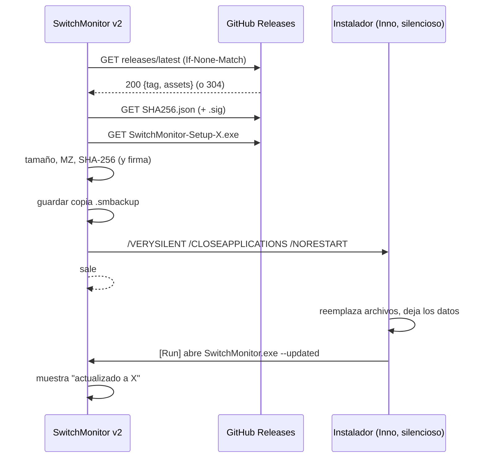

# Sistema de actualización de SwitchMonitor v2 — diseño

Estado: **propuesta, nada implementado** (06/11/2026). Parte de la revisión del motor de la 1.x (`switchMonitor.ahk` líneas 1988–2150, `Update-Helper.ps1`, `packaging/Build.ps1`, `packaging/SwitchMonitor.iss`) y de lo que ya sabemos de la v2 (`run-release.ps1`, `progreso.md`).

## 1. Cómo funciona el motor de la 1.x

| Paso | Qué hace la 1.x |
|---|---|
| **Cuándo mira** | 5 s después de arrancar y cada 6 h (`SetTimer`). También a mano: "Check for updates". |
| **De dónde** | `GET api.github.com/repos/greypaulino/SwitchMonitor/releases/latest`, con tiempos de 5 s y `User-Agent: SwitchMonitor/<versión>`. Un 404 significa "aún no hay versiones". |
| **Qué versión** | Lee `tag_name` (`v?N.N[.N[.N]]`) y compara hasta 4 números (`IsNewerVersion`). |
| **Qué archivos exige** | `SwitchMonitor-Setup-<versión>.exe` y `SHA256.json` en esa misma versión. Las dos direcciones deben ser de `github.com/greypaulino/SwitchMonitor/releases/download/…`. Si falta una: "The release is missing its installer or SHA256 manifest". |
| **Hash** | `SHA256.json` es una lista `{ "File": …, "Hash": … }`. La 1.x busca la línea del instalador con esa versión (64 hex). |
| **Aviso** | Globo de la bandeja ("X is available. Click here to update") y una línea en el menú de la bandeja. |
| **Instalación** | Solo en la edición instalada (no en portable ni desde código). Descarga a `%LOCALAPPDATA%\SwitchMonitor\updates\…part`, comprueba tamaño > 100 KB y cabecera `MZ`, lo renombra y lanza `Update-Helper.ps1` oculto con la ruta, el hash, el PID y la carpeta de la app. |
| **El ayudante** | Comprueba el SHA-256 del instalador, espera hasta 30 s a que la app termine, ejecuta el instalador con `/VERYSILENT /SUPPRESSMSGBOXES /NORESTART /CLOSEAPPLICATIONS`, y reabre `SwitchMonitor.exe --activate`. |
| **Al volver** | Un marcador `update-complete.ini` hace que la app nueva muestre "installed successfully". |
| **Errores** | Cuadro de mensaje con la causa; si es portable, abre la página de la versión. |
| **El instalador** | Inno Setup por usuario (`PrivilegesRequired=lowest`), `AppId {A153C1DB-CA20-448F-B320-37E0448E041A}`, en `%LOCALAPPDATA%\Programs\SwitchMonitor`, con `CloseApplications=yes`. |

Es un motor sencillo y sólido: HTTPS a GitHub, lista blanca de direcciones, hash comprobado dos veces (descarga y ayudante), instalación silenciosa por usuario y sin permisos de administrador.

## 2. Qué adoptamos tal cual

1. **GitHub Releases como única fuente** (`releases/latest`), sin servidor propio.
2. **`SHA256.json` con el mismo formato** y **el nombre `SwitchMonitor-Setup-<versión>.exe`**.
3. **Lista blanca de direcciones** de descarga (solo `github.com/<repo>/releases/download/`).
4. **Comparación numérica de versiones** de hasta 4 partes (portada a C# con las mismas pruebas).
5. **Comprobación doble del hash** y de que el archivo es un ejecutable de tamaño razonable.
6. **Instalación silenciosa por usuario** con cierre de la app y reapertura.
7. **Marcador de "actualización completada"** para confirmar al usuario que salió bien.
8. **Edición portable no se autoinstala**: avisa y abre la página de la versión.

## 3. Lo que cambia en v2 (y mis sugerencias)

1. **Compatibilidad hacia atrás, lo más importante.** Las instalaciones 1.x seguirán buscando `SwitchMonitor-Setup-2.0.0.exe` y `SHA256.json`. Por eso falló la 2.0.0 en la primera publicación: traía solo el zip. **La versión 2 debe publicar un instalador con ese nombre y el `SHA256.json` con ese formato**, aunque la v2 se distribuya también en zip. Así la 1.x se actualiza sola a la v2.
2. **Instalador v2 con el mismo `AppId` y carpeta que el de la 1.x.** Inno Setup reemplaza la 1.x en su sitio (hoy hay `SwitchMonitor.exe` + scripts AutoHotkey; la v2 es un único `SwitchMonitor.exe` autocontenido). El ayudante de la 1.x reabre `…\SwitchMonitor.exe --activate`: la v2 debe **aceptar y ignorar `--activate`** y activar la instancia ya abierta.
3. **Quitar PowerShell del camino.** El ayudante de la 1.x depende de `powershell.exe -ExecutionPolicy Bypass`, algo que los antivirus suelen marcar. En v2 la app comprueba el hash por sí misma (`System.Security.Cryptography`), lanza el instalador y sale; el instalador reabre la app con una entrada `[Run]` de Inno para modo silencioso. No hace falta ayudante. (El de la 1.x sigue funcionando para el salto 1.x→v2.)
4. **Sin `IsEnabled` de "portable.flag"**: la app sabe si es instalada comparando su ruta con la del desinstalador, o si es MSIX por la identidad del paquete (`Package.Current`). En MSIX y en la Store **no se actualiza por su cuenta**: actualiza la Store.
5. **Respetar tus menús de bandeja.** Los menús de bandeja quedaron en 2 y 4 opciones. El aviso de actualización **no añade línea al menú**: va en un globo de la bandeja (clic = instalar), en una franja discreta en la ventana y en **Settings > Updates**.
6. **Solo versiones estables.** `releases/latest` ya excluye borradores y versiones previas. Si más adelante quieres un canal "preview", sería otra consulta con un interruptor.
7. **Ahorrar llamadas a la API.** GitHub limita a 60 por hora y por IP sin cuenta. Con una comprobación cada 6 h sobra, pero conviene guardar el `ETag` y enviar `If-None-Match`: una respuesta 304 no cuenta contra el límite y evita descargar el JSON.
8. **Firma de la lista de hashes (opcional, recomendado).** El hash y el instalador salen del mismo lugar, así que si alguien tomara la cuenta de GitHub podría cambiar ambos. SignPath rechazó el proyecto, y comprar un certificado de firma de código no está en el plan. Alternativa sin coste ni dependencias: una **clave ECDSA P-256 propia** cuyo valor público va incrustado en la app, y `SHA256.json.sig` firmado fuera de línea en cada versión. La app rechaza una lista sin firma válida. Protege contra una cuenta comprometida; no sustituye a la firma de código de Windows.
9. **Copia de seguridad antes de instalar.** La app ya sabe exportar `.smbackup`; guardar una antes de actualizar da una vuelta atrás barata para ajustes y perfiles (están en `%LOCALAPPDATA%`, así que el instalador no los toca).
10. **No actualizar a mitad de una transición.** Esperar a que termine el cambio de perfil en curso y a que la cobertura negra esté fuera.
11. **El teléfono tiene su propia vía.** El APK se firma aparte (sin esa clave no hay actualizaciones del APK). El PC puede avisar de una versión nueva del APK, pero se instala desde el teléfono.

## 4. Diseño propuesto

**Componentes (todo en `SwitchMonitor.Core`, sin dependencias nuevas)**

| Pieza | Responsabilidad |
|---|---|
| `VersionNumber` | Analiza y compara versiones de hasta 4 partes (portado de `IsNewerVersion`). |
| `ReleaseFeed` | Consulta `releases/latest` con `HttpClient`, `ETag`, tiempos de 5 s; devuelve versión y los dos archivos permitidos. |
| `UpdateManifest` | Lee `SHA256.json` (mismo formato que la 1.x, con o sin BOM) y, si existe, comprueba `SHA256.json.sig`. |
| `UpdateDownloader` | Descarga a `…\updates\*.part`, comprueba tamaño y `MZ`, verifica el hash y renombra. |
| `UpdateService` | Estados y reglas (cuándo mirar, qué edición, si hay transición en curso); lanza el instalador. |
| `UpdateViewModel` + tarjeta en Settings | Muestra versión, última comprobación, estado y botones. |

**Estados:** `Idle → Checking → UpToDate | Available(versión) → Downloading(%) → Verifying → ReadyToInstall → Installing`, y `Failed(causa)` desde cualquier paso, siempre con el archivo y el motivo en el log.

**Interfaz**

- **Settings > Updates:** versión actual, "Última comprobación: hace 2 h", estado, `Check now`, `Install and restart` (cuando hay versión), interruptor `Check automatically` (activado).
- **Aviso:** globo de bandeja la primera vez que se detecta una versión; franja con "Update available · Install" en la cabecera de la ventana; nada en los menús de bandeja.
- **Tras instalar:** la ventana abre con "SwitchMonitor X instalado".

**Reglas por edición**

| Edición | Comprobar | Instalar |
|---|---|---|
| Instalada (Inno) | Sí | Sí, automático |
| Portable (zip) | Sí | No: avisa y abre la página de la versión |
| MSIX / Store | No (lo hace la Store) | No |
| Demo / pruebas | No | No |

**Pruebas (sin red)**

- Comparación de versiones, lectura de `SHA256.json` (BOM, mayúsculas/minúsculas, entrada ausente), lista blanca de direcciones, cabecera `MZ`, tamaño, hash correcto/incorrecto, firma válida/ausente/falsa.
- Un servidor local de pruebas (`HttpListener`) que imita `releases/latest`, el manifiesto y el instalador, con 404, 304, hash cambiado y descarga cortada.
- No se ejecuta un instalador real en las pruebas; se prueba el lanzamiento con un ejecutable de mentira y la comprobación de argumentos.

## 5. Publicar una versión (lo que debe contener)

`SwitchMonitor-Setup-<versión>.exe`, `SwitchMonitor-<versión>-win-x64.zip` (portable), `SHA256.json` con **las dos entradas** (`File`, `Hash` en mayúsculas), y, si se adopta la firma, `SHA256.json.sig`. Una sola fuente de la versión (`VERSION`) para el exe, el instalador y las notas. La versión se publica desde GitHub Actions (plan de la fase 4).

## 6. Plan por fases

| Fase | Contenido |
|---|---|
| **1. Compatibilidad** | Instalador Inno v2 con el `AppId` de la 1.x, `SHA256.json` en formato 1.x, `--activate` aceptado. Con esto la 1.x ya se actualiza a la v2. |
| **2. Motor** | `VersionNumber`, `ReleaseFeed`, `UpdateManifest`, `UpdateDownloader`, `UpdateService` y sus pruebas. |
| **3. Interfaz** | Tarjeta en Settings, franja en la ventana, globo de bandeja, marcador "actualizado". |
| **4. Endurecimiento** | `ETag`, copia `.smbackup`, no actualizar durante transiciones, firma de `SHA256.json`. |
| **5. Ediciones** | Detección de portable/MSIX; la Store gestiona su propia actualización. |

## 7. Decisiones que necesito

1. **¿Instalador Inno para la v2?** Es lo que hace funcionar la actualización desde la 1.x sin cambiar el motor viejo. La alternativa es no soportar el salto automático 1.x→v2 y pedir una instalación manual.
2. **¿Firma propia de `SHA256.json`?** Más seguridad, pero hay que guardar otra clave fuera de línea (como la del APK).
3. **¿Actualizar sola o preguntar?** Propongo: avisar siempre, instalar solo con tu clic.
4. **¿Intervalo de comprobación?** Propongo 6 h como en la 1.x, más una comprobación al abrir la ventana.
5. **¿Quieres que la edición portable pueda actualizarse sola** (descargar el zip y reemplazar) o que solo avise?
